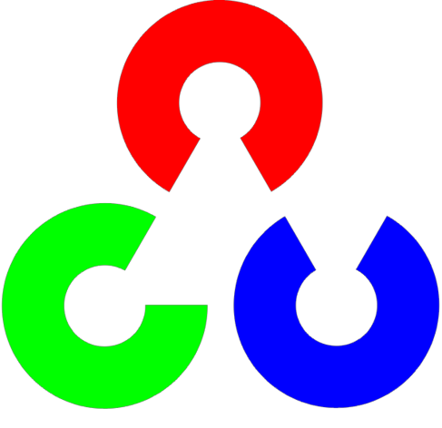
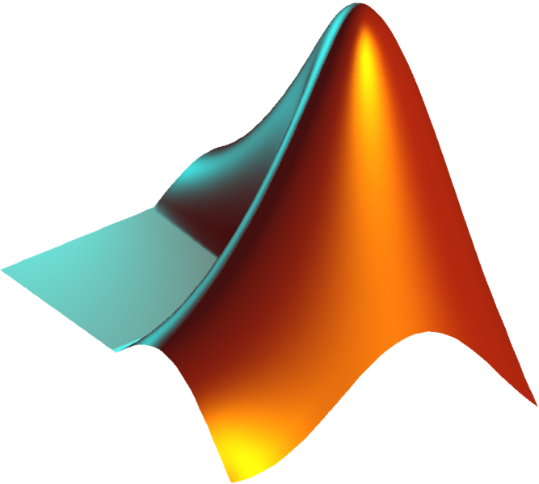

### Salutations! Welcome to my GitHub profile page! ʕ•ᴥ•ʔ

<h4 align="left">Check Out My Website:</h4>
<a href="https://liamchalk00.github.io/">liamchalk00.github.io</a>

<h4>Social Media:</h4>

<h4 align="left">Coding Languages and Libraries:</h4>

<table>
  <tr>
    <td align="center" width="96"> Verilog</td>
    <td align="center" width="96"> Python</td>
    <td align="center" width="96"> C++</td>
    <td align="center" width="96"> Java</td>
    <td align="center" width="96"> HTML</td>
    <td align="center" width="96"> OpenCV</td>
    <td align="center" width="96"> Matlab</td>
    <td align="center" width="96"> Git</td>
    <td align="center" width="96"> Django</td>
    <td align="center" width="96"> React</td>
    <td align="center" width="96"> TCL</td>
  </tr>
</table>

  
   
  <small>Public Repository Languages</small>
   
   
  

## Repository and language context

The graph shows public repositories associated with this account and the languages GitHub detects in each.

```mermaid
flowchart LR
    account["liamchalk00"]

    subgraph repositories["Repositories"]
        r1["liamchalk00.github.io"]
        r2["cvw"]
        r3["ConnectFour"]
        r4["DjangoTemplate"]
        r5["simple-django-login-and-register2"]
        r6["Backtesting"]
        r7["ReactDocker"]
        r8["2D_3D"]
        r9["pythoncode-tutorials"]
        r10["Resume"]
        r11["liamchalk00"]
        r12["CovidGenomeAnalysis"]
        r13["BioCalculator"]
        r14["NetflixOracle"]
        r15["HDLCoderCourse"]
        r16["HDLCoderLiam"]
        r17["HDLCoderInstructor"]
    end

    subgraph languages["GitHub-detected languages"]
        l1["CSS"]
        l2["HTML"]
        l3["JavaScript"]
        l4["SCSS"]
        l5["Assembly"]
        l6["C"]
        l7["C++"]
        l8["Makefile"]
        l9["Perl"]
        l10["Python"]
        l11["Shell"]
        l12["Stata"]
        l13["SystemVerilog"]
        l14["Tcl"]
        l15["Verilog"]
        l16["TeX"]
        l17["Dockerfile"]
        l18["MATLAB"]
        l19["Batchfile"]
        l20["Pascal"]
        l21["PureBasic"]
        l22["VHDL"]
        l23["R"]
        l24["Jupyter Notebook"]
    end

    account --> r1
    account --> r2
    account --> r3
    account --> r4
    account --> r5
    account --> r6
    account --> r7
    account --> r8
    account --> r9
    account --> r10
    account --> r11
    account --> r12
    account --> r13
    account --> r14
    account --> r15
    account --> r16
    account --> r17

    r1 --> l1
    r1 --> l2
    r1 --> l3
    r1 --> l4
    r2 --> l5
    r2 --> l6
    r2 --> l7
    r2 --> l8
    r2 --> l9
    r2 --> l10
    r2 --> l11
    r2 --> l12
    r2 --> l13
    r2 --> l14
    r2 --> l15
    r3 --> l10
    r4 --> l1
    r4 --> l2
    r4 --> l10
    r5 --> l1
    r5 --> l2
    r5 --> l3
    r5 --> l10
    r6 --> l1
    r6 --> l2
    r6 --> l10
    r7 --> l17
    r7 --> l2
    r7 --> l3
    r7 --> l4
    r7 --> l11
    r8 --> l10
    r9 --> l1
    r9 --> l2
    r9 --> l10
    r9 --> l11
    r9 --> l24
    r10 --> l16
    r11 --> l1
    r11 --> l2
    r11 --> l3
    r11 --> l4
    r12 --> l2
    r12 --> l10
    r12 --> l23
    r13 --> l2
    r13 --> l10
    r14 --> l1
    r14 --> l2
    r14 --> l3
    r15 --> l18
    r16 --> l19
    r16 --> l6
    r16 --> l1
    r16 --> l2
    r16 --> l3
    r16 --> l18
    r16 --> l20
    r16 --> l11
    r16 --> l12
    r16 --> l14
    r16 --> l22
    r16 --> l15
    r17 --> l19
    r17 --> l6
    r17 --> l1
    r17 --> l2
    r17 --> l3
    r17 --> l18
    r17 --> l8
    r17 --> l20
    r17 --> l21
    r17 --> l11
    r17 --> l12
    r17 --> l14
    r17 --> l22
    r17 --> l15
```

